# Orca Deck

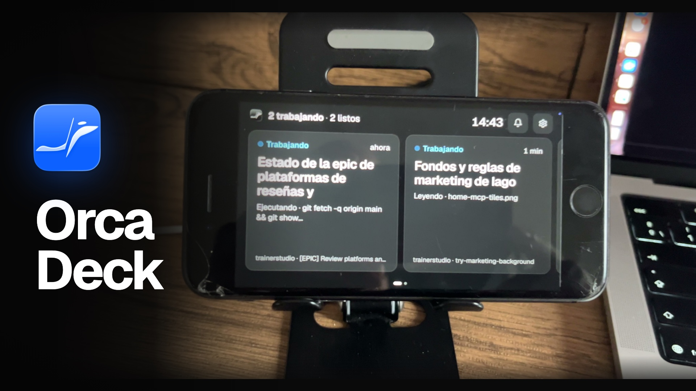

Side display for [Orca](https://github.com/stablyai/orca) agents, meant for an iPhone used as an extra Mac screen
via OpenDisplay. At a glance: who needs you, who is working, what just finished — and answer Sí/No with one tap.

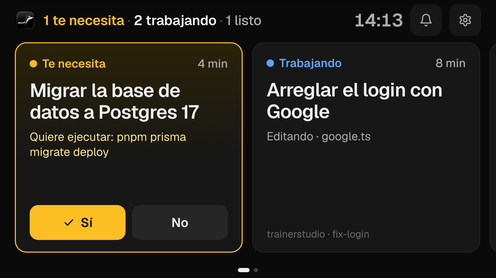

## Light and dark

Follows the Mac's light/dark appearance by default (Orca's light and dark tokens). Force one in
⚙️ → **Tema**: Auto, Claro, Oscuro.

| Claro: lista | Claro: foco + cola | Claro: ajustes |
|---|---|---|
| 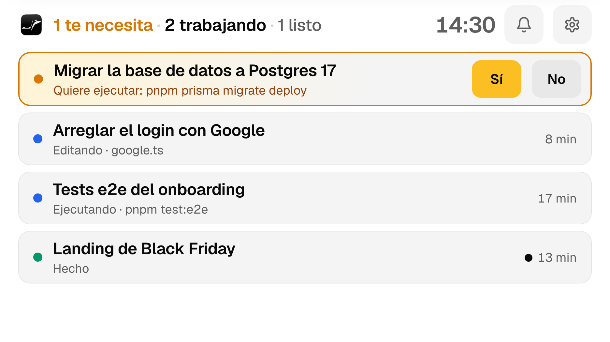 | 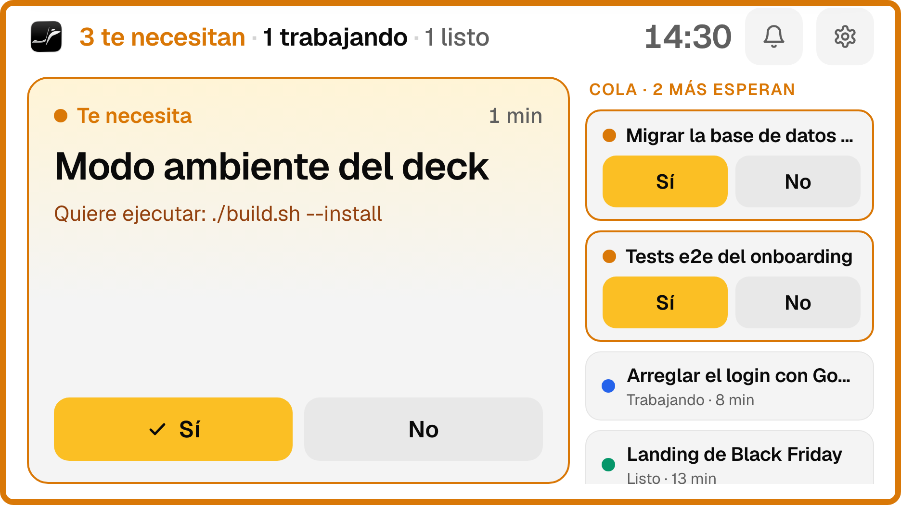 | 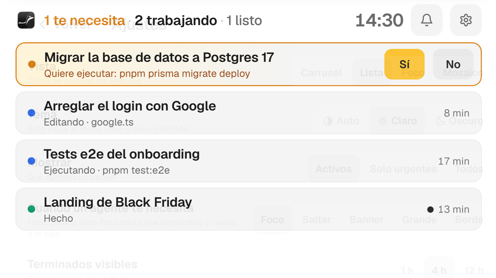 |

## Portrait

Hold the phone upright and OpenDisplay turns the Mac display into 526×936; the deck switches to a portrait
canvas automatically (and back when you turn it again). Every view, alert and the settings adapt.

| Lista | Foco + cola | Detalle |
|---|---|---|
| 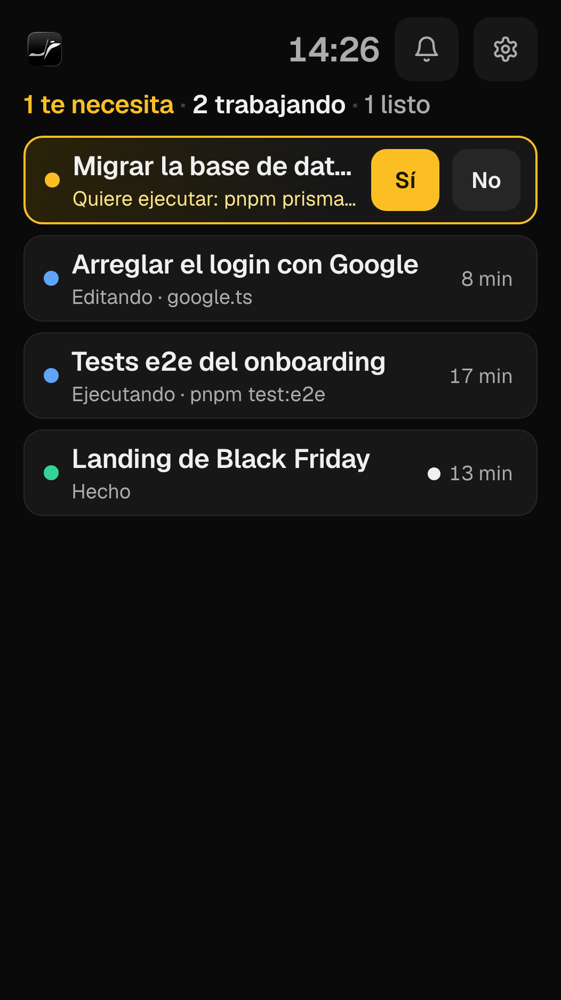 | 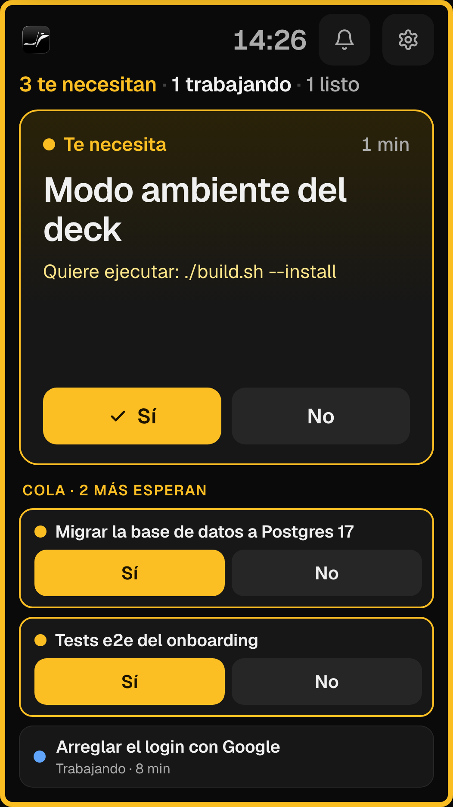 | 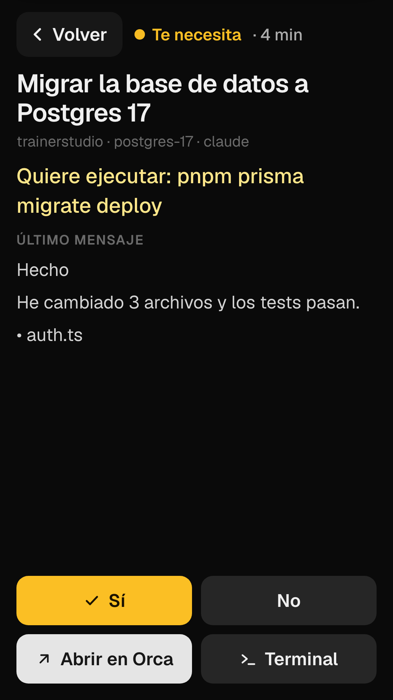 |

## Views (gear ⚙️ menu)

| Lista | Foco | Mosaico |
|---|---|---|
| 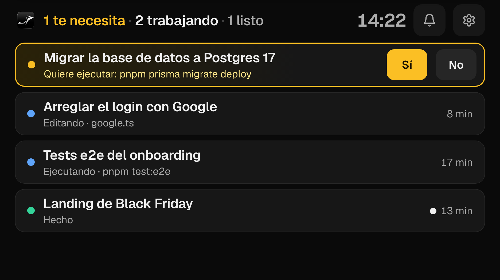 | 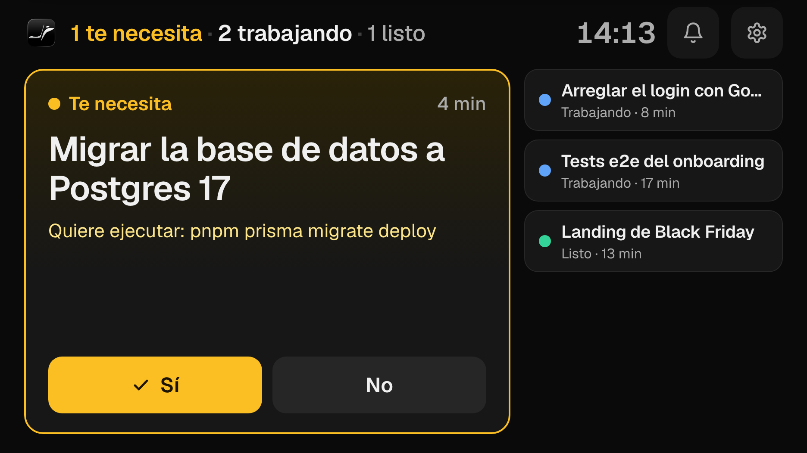 | 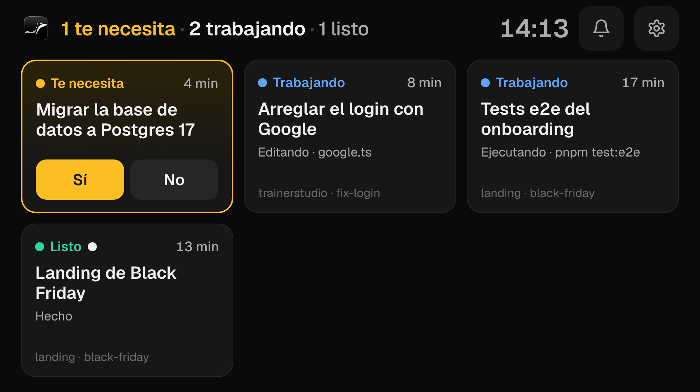 |

| Ajustes | Aviso: banner | Aviso: pantalla completa |
|---|---|---|
| 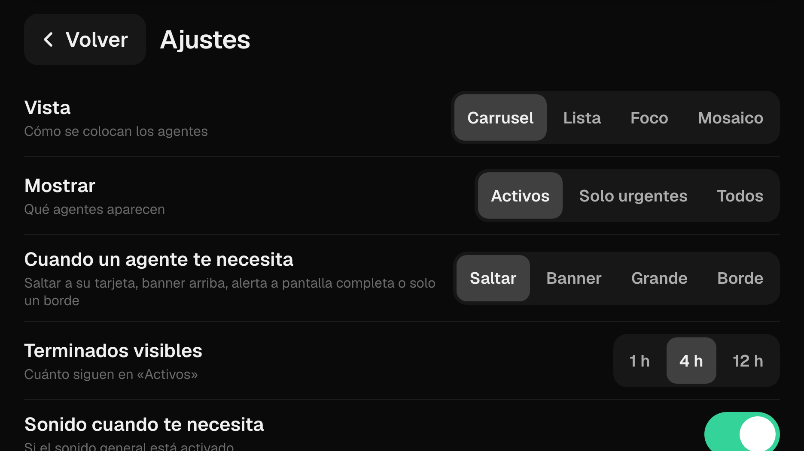 | 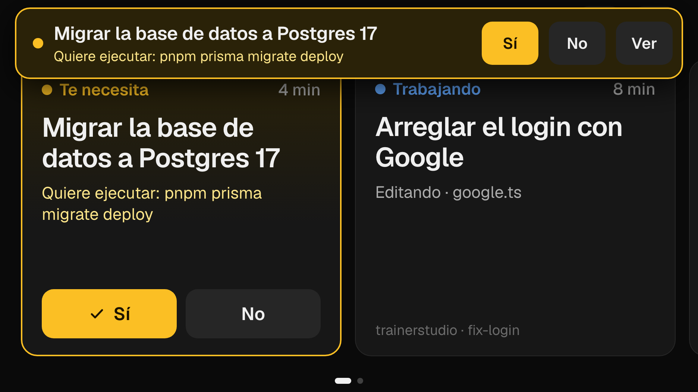 | 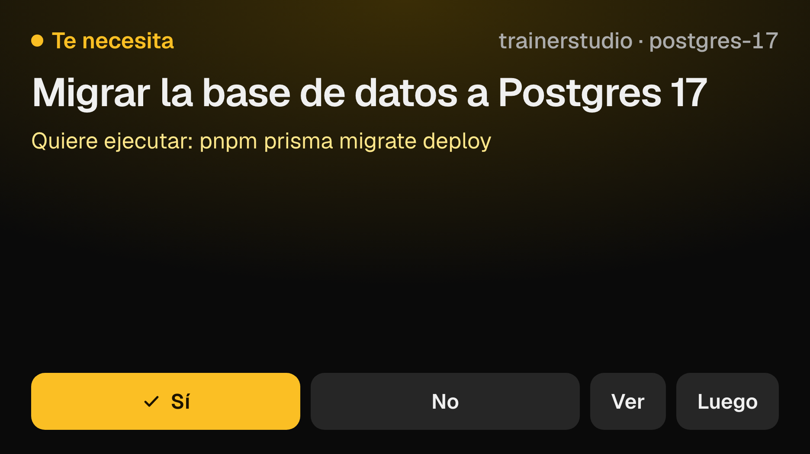 |

| Foco automático + cola | Terminal fijado | Modo ambiente |
|---|---|---|
| 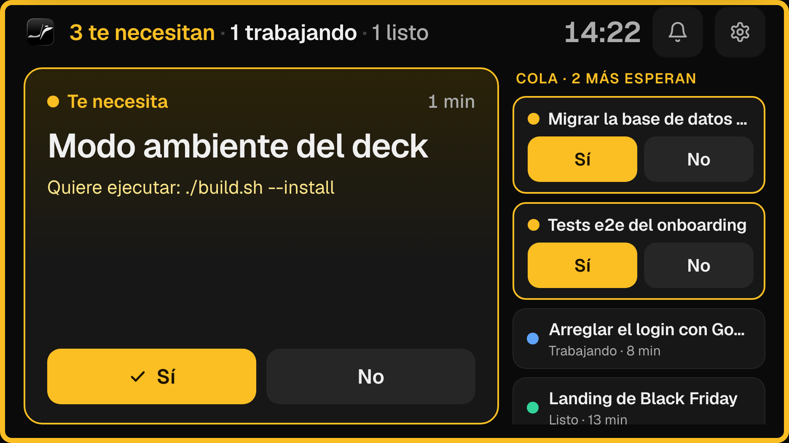 | 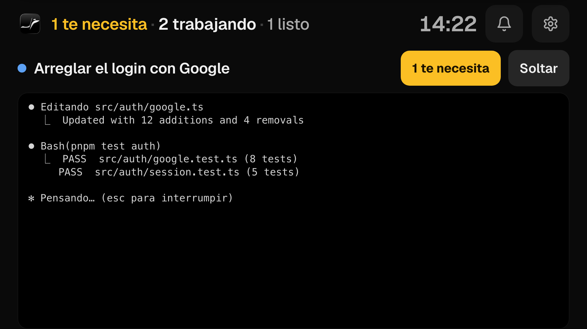 | 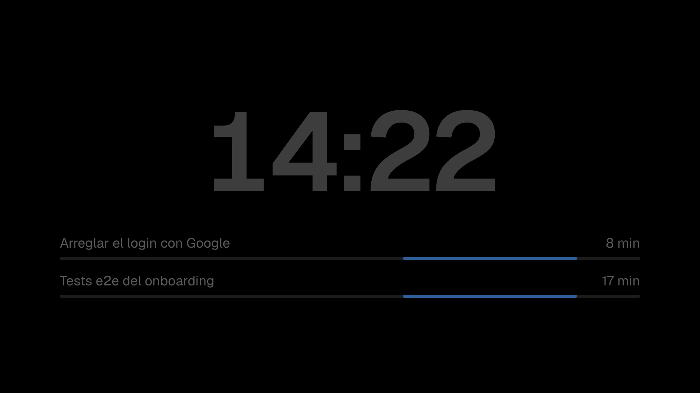 |

The gear menu (saved per device) sets:
- **Tema**: Auto (follows macOS), Claro, Oscuro.
- **Vista**: Lista (default), Carrusel, Foco (most urgent agent big + side strip), Mosaico.
- **Mostrar**: active agents, only urgent ones, or all.
- **Cuando un agente te necesita**: *Foco* (default: switch to Foco with an amber border until you answer, then
  back to your view; with 2+ waiting the side strip becomes an approval queue with Sí/No), jump to its card,
  top banner, full-screen alert, or just an amber border.
- **Escalation**: repeat the alert after 2 min, go full screen after 5 min unanswered. Green flash when an agent finishes.
- **Modo ambiente**: after 10 min with nothing waiting and no touches, dims to a clock and thin activity bars;
  any alert or touch wakes it.
- **Fijar terminal**: in an agent's Terminal view, *Fijar* keeps its live terminal as the home screen
  (an amber pill shows if another agent needs you; *Soltar* unpins).
- Separate sounds for "needs you" and "finished", how long finished agents stay visible, auto-return home.
- **Devolver el puntero al Mac**: OpenDisplay turns touches into real mouse events, which drags the Mac pointer
  onto the phone. Orca Deck hides it while the finger is down and warps it back where it was afterwards.
  Touches are recognised by the event's source process (OpenDisplay) or by the pointer teleporting onto the deck.

## Keeps working on its own

- **The Mac's Dock never moves to the phone.** macOS moves the Dock to whichever screen the pointer pushes
  against the Dock edge of, and OpenDisplay turns touches near the phone's edge into exactly that. Orca Deck
  nudges pointer events in a thin strip along the phone's Dock edge a few points inward (an event tap, like
  [DockPin](https://github.com/green2grey/DockPin)), and if the Dock still lands on the phone it pushes it back to
  the main display. Needs **Accessibility** for Orca Deck (System Settings → Privacy & Security → Accessibility);
  until it has it the header shows ⚠️ and Ajustes has a *Dar permiso* button. Turn it off in ⚙️ → *Dock fuera del iPhone*.
- **Opens and unsticks OpenDisplay.** Open Orca Deck with the phone plugged in and it goes to the phone: it starts
  OpenDisplay's Mac app if it isn't running (it doesn't come back by itself after a reboot), and restarts it when
  the phone is on USB but no phone screen shows up for 45 s (at most 3 times per plug-in, 2 min apart).
  Without the phone, the deck stays on the Mac showing what it is waiting for, and moves to the phone when it appears.
  ⚙️ → *Reconectar OpenDisplay* turns this off.
- **Orca chats.** Agents that run as Orca chats (not terminals) show *Responder en Orca* when they need you and a
  *Conversación* view (`orca agent read`); the CLI can't answer a chat's permission prompt, so that happens in Orca.
- **Orca updates.** On launch it checks `orca agent-context --json` for every command it uses and shows
  *Orca cambió* (⚙️ lists what is missing) if an Orca update removed one. Orca is found by bundle id, wherever it is installed.

Status of all three (iPhone, Dock, Orca version) is at the top of ⚙️ Ajustes.

## How it works

- Native AppKit panel (`main.swift`; Dock guard, OpenDisplay watchdog and Orca check in `system.swift`) that covers the
  whole display whose name contains "iPhone"/"OpenDisplay" (override with `DECK_SCREEN=<name>`), menu bar area
  included. It is on every Space and above other windows on that screen, so switching apps or Spaces on the Mac
  never takes it off the phone: it stays until you quit it (Dock → Quit) or close OpenDisplay on the phone.
  It is non-activating: touching it never takes keyboard focus from the Mac app you are in.
  Clicking the Dock icon while it runs puts it back on the phone.
- UI is a fixed 936×526 canvas in landscape or 526×936 in portrait (iPhone 8 via OpenDisplay), scaled to fit, using Orca's dark
  theme tokens and the Geist font.
- Polls `orca worktree ps --json` + `orca terminal list --json` every 1.5 s.
- UI is `web/index.html` (WKWebView). It can only run whitelisted `orca` subcommands.

## Build

`./build.sh --install` → `~/Applications/Orca Deck.app` (drag it to the Dock for one-click launch). It restarts a
running copy.

Run `./make-signing-cert.sh` once first: it creates a self-signed "Orca Deck Local Signing" identity in your login
keychain and `build.sh` signs with it, so macOS keeps the Accessibility permission across rebuilds (an ad-hoc
signature changes every build and macOS forgets the permission). `ORCA_DECK_SIGN_ID` picks another identity.

Touch on the phone needs OpenDisplay to have Accessibility permission on the Mac.

## Dev

- `DECK_WEB_DIR=$PWD/web "build/Orca Deck.app/Contents/MacOS/OrcaDeck"` loads the HTML from disk.
- `DECK_SNAPSHOT=/tmp/x.png DECK_SNAPSHOT_JS='…'` saves a PNG of the window after load.
- Opening `web/index.html` in a browser shows mock data; query params preview settings,
  e.g. `?layout=list`, `?view=settings`, `?view=banner`, `?view=full`, `?view=autofocus&waiting=2`,
  `?view=pinned`, `?view=ambient`, `?view=detail`.
  Open it in a tall window (e.g. 526×936) to preview portrait; add `&theme=light` or `&theme=dark`.
- Touch detection, the Dock guard, OpenDisplay restarts and Orca compatibility are logged to `~/Library/Logs/OrcaDeck.log`.
- Previews of the new states: `?sys=needsPermission`, `?compat=old`, `?view=nophone`, `?chat=1`.
