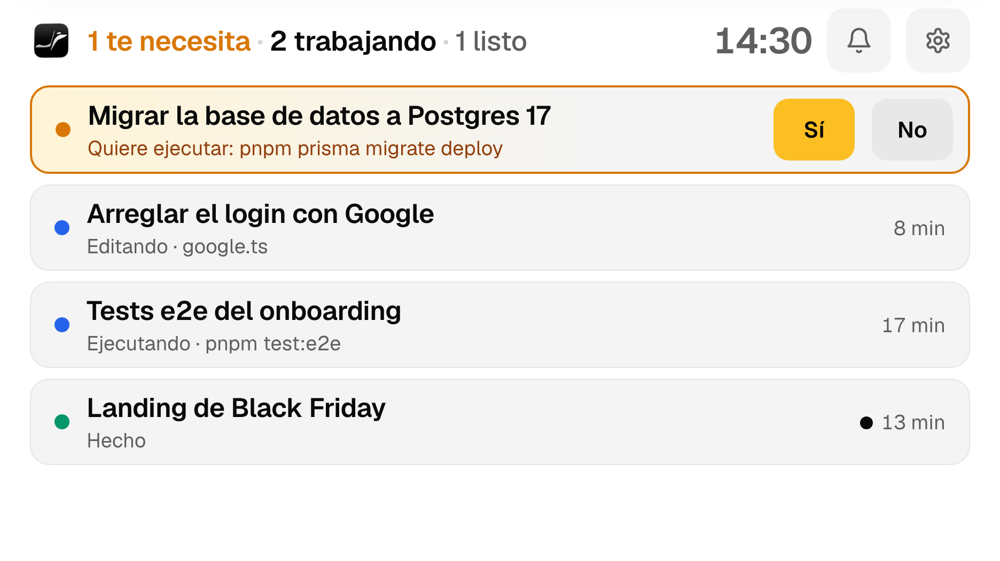
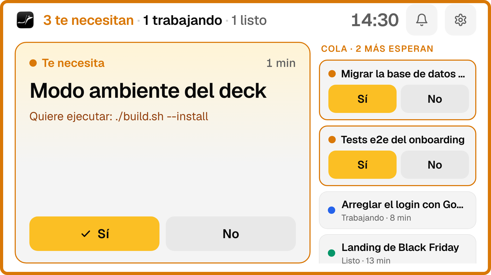
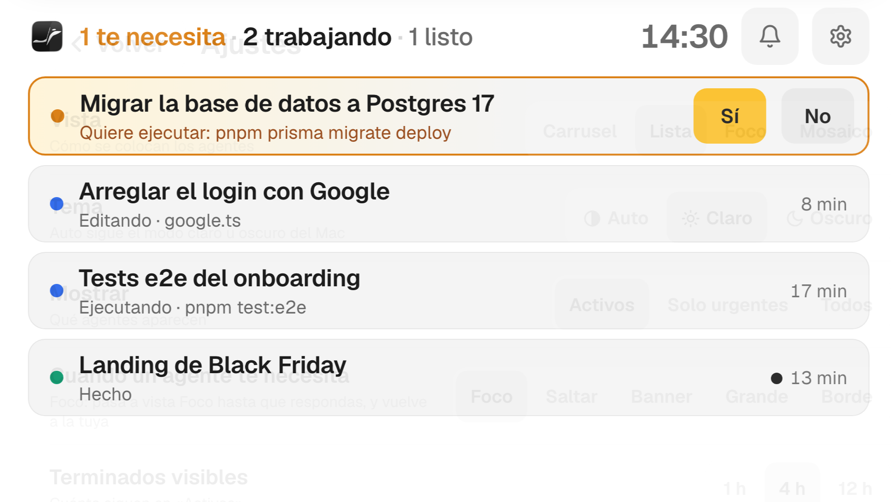
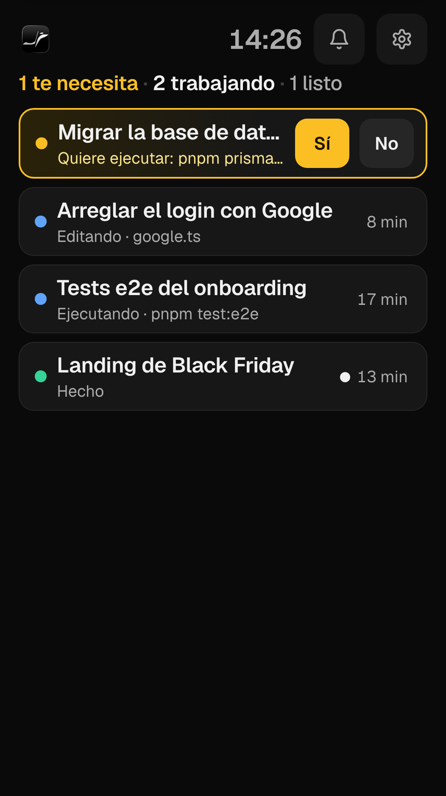
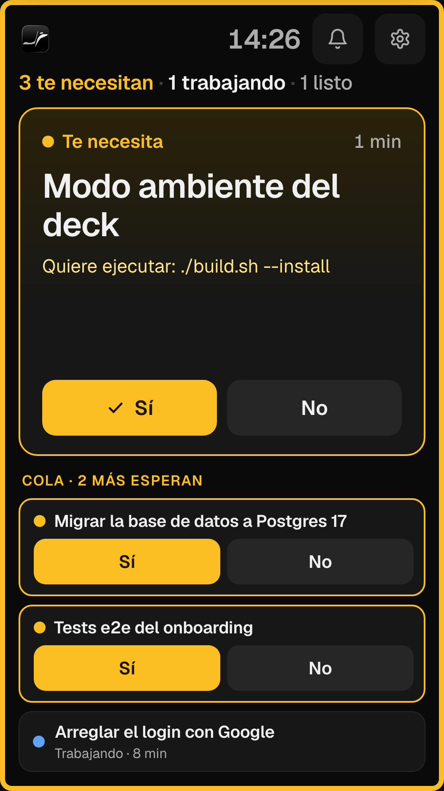
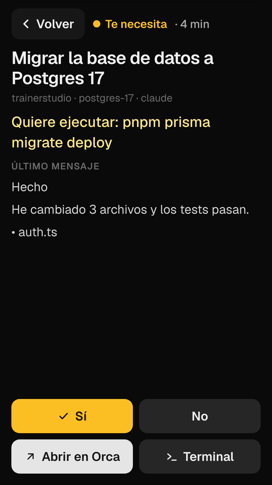
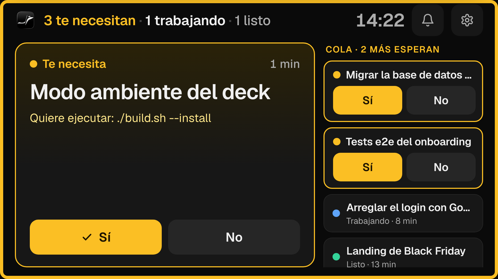
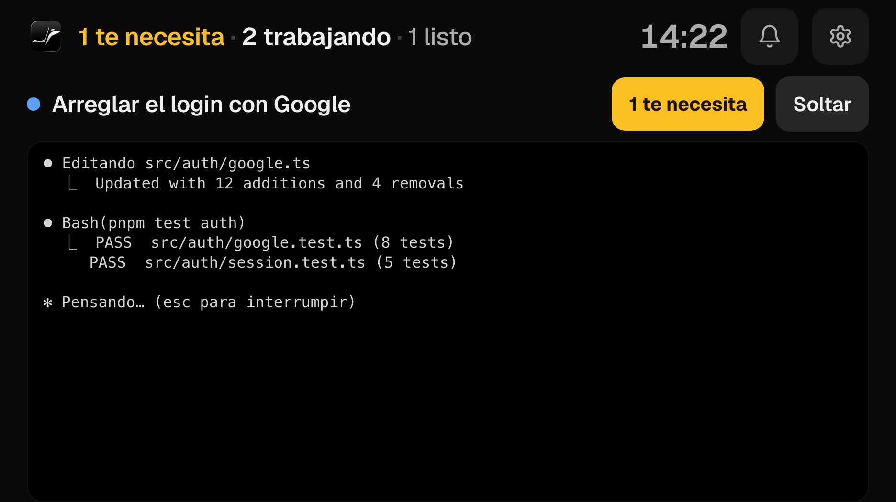
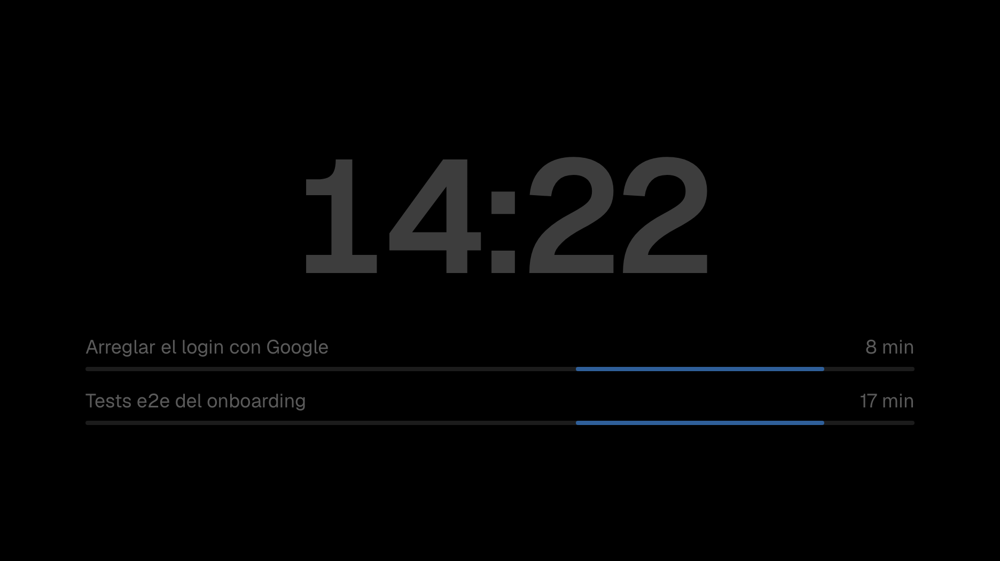

# Orca Deck

Side display for [Orca](https://github.com/stablyai/orca) agents, meant for an iPhone used as an extra Mac screen
via OpenDisplay. At a glance: who needs you, who is working, what just finished — and answer Sí/No with one tap.

## Light and dark

Follows the Mac's light/dark appearance by default (Orca's light and dark tokens). Force one in
⚙️ → **Tema**: Auto, Claro, Oscuro.

| Claro: lista | Claro: foco + cola | Claro: ajustes |
|---|---|---|
|  |  |  |

## Portrait

Hold the phone upright and OpenDisplay turns the Mac display into 526×936; the deck switches to a portrait
canvas automatically (and back when you turn it again). Every view, alert and the settings adapt.

| Lista | Foco + cola | Detalle |
|---|---|---|
|  |  |  |

## Views (gear ⚙️ menu)

| Lista | Foco | Mosaico |
|---|---|---|
|  |  |  |

| Ajustes | Aviso: banner | Aviso: pantalla completa |
|---|---|---|
|  |  |  |

| Foco automático + cola | Terminal fijado | Modo ambiente |
|---|---|---|
|  |  |  |

The gear menu (saved per device) sets:
- **Tema**: Auto (follows macOS), Claro, Oscuro.
- **Vista**: Lista (default), Carrusel, Foco (most urgent agent big + side strip), Mosaico.
- **Mostrar**: active agents, only urgent ones, or all.
- **Cuando un agente te necesita**: *Foco* (default: switch to Foco with an amber border until you answer, then
  back to your view; with 2+ waiting the side strip becomes an approval queue with Sí/No), jump to its card,
  top banner, full-screen alert, or just an amber border.
- **Escalation**: repeat the alert after 2 min, go full screen after 5 min unanswered. Green flash when an agent finishes.
- **Modo ambiente**: after 10 min with nothing waiting and no touches, dims to a clock and thin activity bars;
  any alert or touch wakes it.
- **Fijar terminal**: in an agent's Terminal view, *Fijar* keeps its live terminal as the home screen
  (an amber pill shows if another agent needs you; *Soltar* unpins).
- Separate sounds for "needs you" and "finished", how long finished agents stay visible, auto-return home.
- **Devolver el puntero al Mac**: OpenDisplay turns touches into real mouse events, which drags the Mac pointer
  onto the phone. Orca Deck hides it while the finger is down and warps it back where it was afterwards.
  Touches are recognised by the event's source process (OpenDisplay) or by the pointer teleporting onto the deck.

## How it works

- Native AppKit window (`main.swift`) that goes native full screen (own Space, no menu bar) on the
  display whose name contains "iPhone"/"OpenDisplay" (override with `DECK_SCREEN=<name>`).
  After each tap it hands keyboard focus back to the previous app (usually Orca).
  Clicking the Dock icon while it runs puts it back on the phone.
- UI is a fixed 936×526 canvas in landscape or 526×936 in portrait (iPhone 8 via OpenDisplay), scaled to fit, using Orca's dark
  theme tokens and the Geist font.
- Polls `orca worktree ps --json` + `orca terminal list --json` every 1.5 s.
- UI is `web/index.html` (WKWebView). It can only run whitelisted `orca` subcommands.

## Build

`./build.sh --install` → `~/Applications/Orca Deck.app` (drag it to the Dock for one-click launch).

Touch on the phone needs OpenDisplay to have Accessibility permission on the Mac.

## Dev

- `DECK_WEB_DIR=$PWD/web "build/Orca Deck.app/Contents/MacOS/OrcaDeck"` loads the HTML from disk.
- `DECK_SNAPSHOT=/tmp/x.png DECK_SNAPSHOT_JS='…'` saves a PNG of the window after load.
- Opening `web/index.html` in a browser shows mock data; query params preview settings,
  e.g. `?layout=list`, `?view=settings`, `?view=banner`, `?view=full`, `?view=autofocus&waiting=2`,
  `?view=pinned`, `?view=ambient`, `?view=detail`.
  Open it in a tall window (e.g. 526×936) to preview portrait; add `&theme=light` or `&theme=dark`.
- Touch detection is logged to `~/Library/Logs/OrcaDeck.log`.
