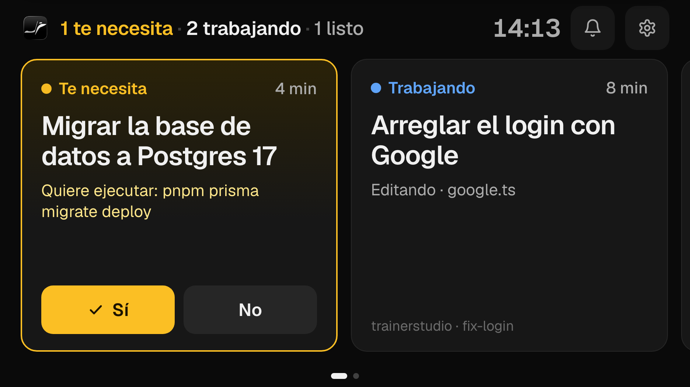
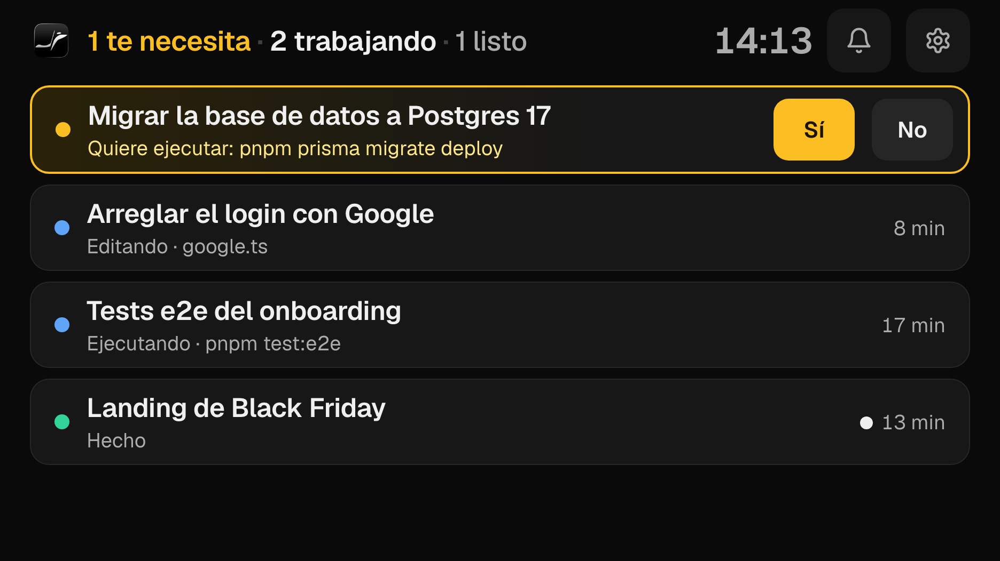
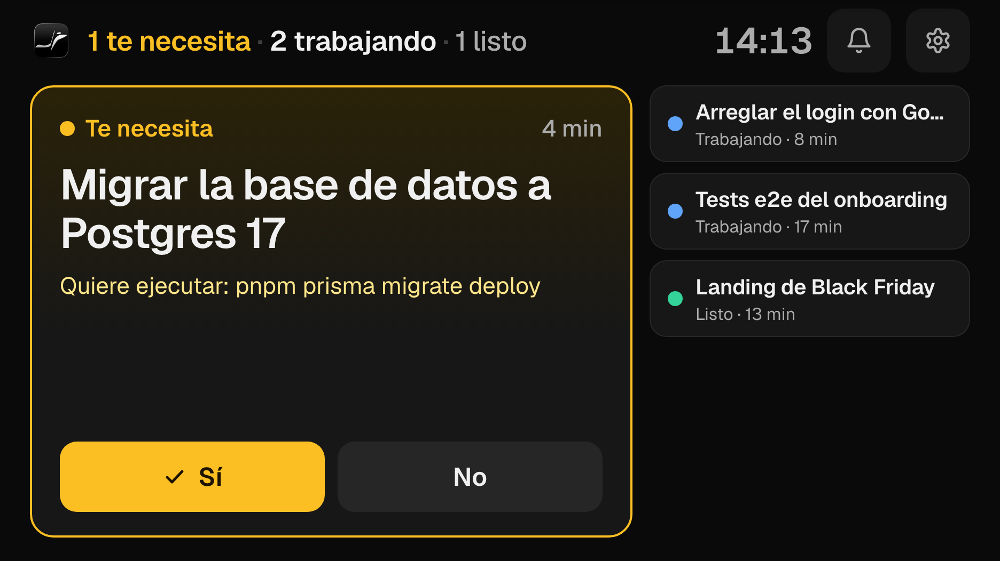
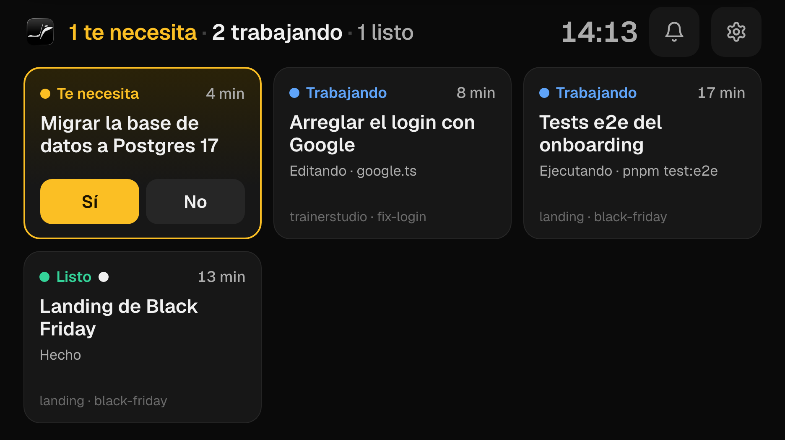
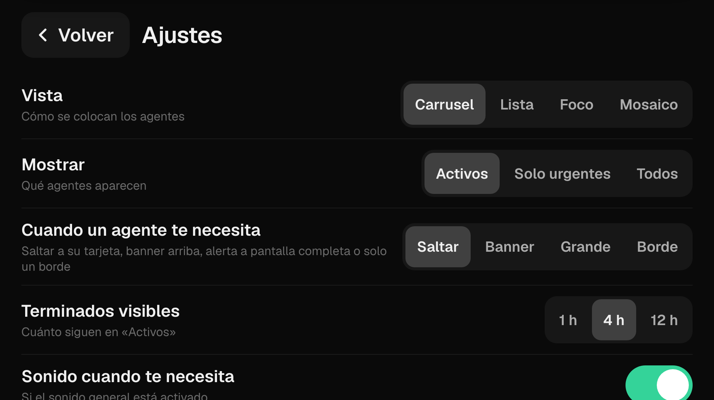
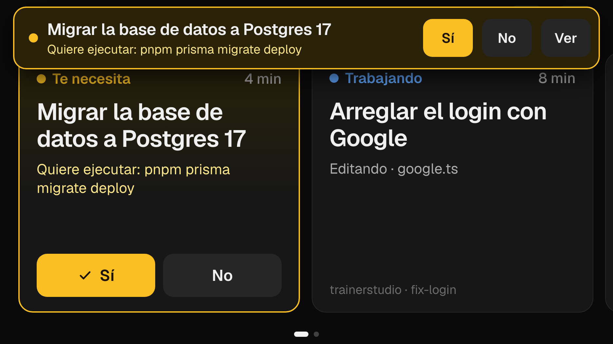
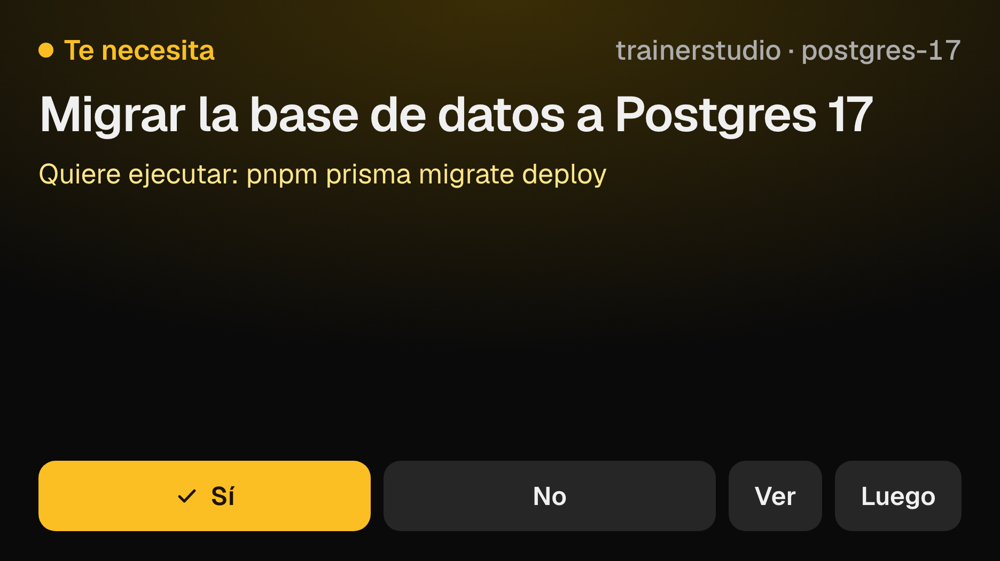

# Orca Deck

Side display for [Orca](https://github.com/stablyai/orca) agents, meant for an iPhone used as an extra Mac screen
via OpenDisplay. At a glance: who needs you, who is working, what just finished — and answer Sí/No with one tap.

## Views (gear ⚙️ menu)

| Lista | Foco | Mosaico |
|---|---|---|
|  |  |  |

| Ajustes | Aviso: banner | Aviso: pantalla completa |
|---|---|---|
|  |  |  |

The gear menu (saved per device) sets:
- **Vista**: Carrusel, Lista, Foco (most urgent agent big + side strip), Mosaico.
- **Mostrar**: active agents, only urgent ones, or all.
- **Cuando un agente te necesita**: jump to its card, top banner, full-screen alert, or just an amber border.
- Separate sounds for "needs you" and "finished", how long finished agents stay visible, auto-return home.
- **Devolver el puntero al Mac**: OpenDisplay turns touches into real mouse events, which drags the Mac pointer
  onto the phone. Orca Deck hides it while the finger is down and warps it back where it was afterwards.
  Touches are recognised by the event's source process (OpenDisplay) or by the pointer teleporting onto the deck.

## How it works

- Native AppKit window (`main.swift`) that goes native full screen (own Space, no menu bar) on the
  display whose name contains "iPhone"/"OpenDisplay" (override with `DECK_SCREEN=<name>`).
  After each tap it hands keyboard focus back to the previous app (usually Orca).
  Clicking the Dock icon while it runs puts it back on the phone.
- UI is a fixed 936×526 canvas (iPhone 8 landscape via OpenDisplay), scaled to fit, using Orca's dark
  theme tokens and the Geist font.
- Polls `orca worktree ps --json` + `orca terminal list --json` every 1.5 s.
- UI is `web/index.html` (WKWebView). It can only run whitelisted `orca` subcommands.

## Build

`./build.sh --install` → `~/Applications/Orca Deck.app` (drag it to the Dock for one-click launch).

Touch on the phone needs OpenDisplay to have Accessibility permission on the Mac.

## Dev

- `DECK_WEB_DIR=$PWD/web "build/Orca Deck.app/Contents/MacOS/OrcaDeck"` loads the HTML from disk.
- `DECK_SNAPSHOT=/tmp/x.png DECK_SNAPSHOT_JS='…'` saves a PNG of the window after load.
- Opening `web/index.html` in a browser shows mock data; query params preview settings,
  e.g. `?layout=list`, `?view=settings`, `?view=banner`, `?view=full`.
- Touch detection is logged to `~/Library/Logs/OrcaDeck.log`.
